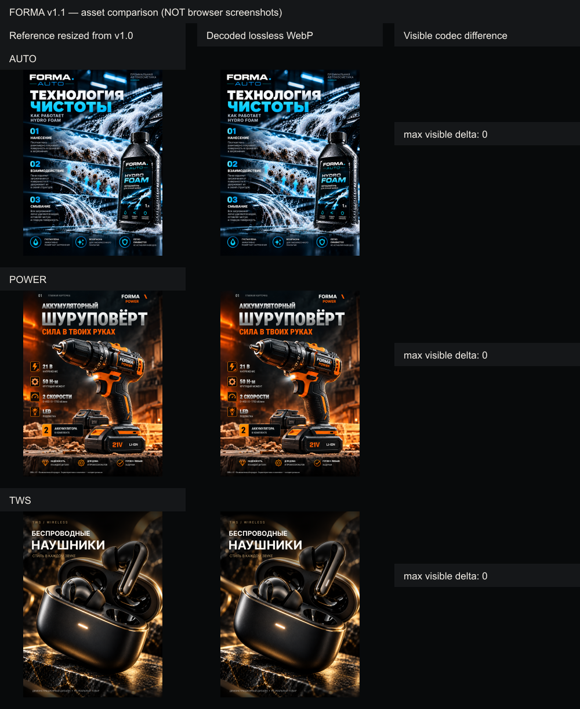

# FORMA v1.1 — оптимизация изображений и мобильной читаемости

Подготовлено по аудиту от 21.10.2026. База: `c123bedd0e67973ea9ace44747fb0e162fc62d0f`.
Точка отката: ветка `backup/v1.0-before-v1.1` на том же коммите.

## Изменения

- 21 адаптивный lossless WebP для карточек, логотипа и двух вариантов фона.
- 21 lossless AVIF-кандидат подготовлен для сравнения в `avif-candidates/`. В сумме AVIF занимает 9 286 260 байт, WebP — 7 853 520 байт. В выдаче используется WebP: это меньший объём и прежний кодек без неподтверждённого изменения LCP-пути. AVIF не входит в публикуемый артефакт.
- Native `img` с `srcset/sizes` согласованы между SSR HTML, Flight-данными Next.js и клиентским компонентом Brand. Это адаптация готового статического экспорта, не пересборка оригинального приложения.
- Прежние четыре слота ранней загрузки сохранены. Полноразмерные preload заменены адаптивными `imagesrcset/imagesizes`, совпадающими с конечными `img`; двойная загрузка WebP и AVIF не вводится. Сокращение числа preload без измерений LCP не делалось.
- Полноразмерные PNG Auto, Power, TWS по клику сохранены побайтово.
- Мобильные подписи карточек и список маркетплейсов увеличены до 11 px, для подписи разрешён перенос.
- CTA заменён на «Смотреть дизайн-концепты» и ведёт к существующим карточкам `#concepts`. Коммерческие кейсы и заказы не добавлялись.
- Удалены пять действительно неиспользуемых шаблонов: file.svg, globe.svg, next.svg, vercel.svg, window.svg.
- Для изменённых CSS/JS созданы новые имена с SHA-256. Старые URL CSS/JS и исходных изображений сохранены для совместимости с закэшированными страницами. Их удаление из действующего артефакта требует отдельного будущего решения после выкладки.
- CNAME, robots.txt, sitemap.xml, favicon, контакты и SEO-метаданные сохранены. Workflow и настройки публикации не менялись.

## Реальные размеры и расчёт загрузки

Размеры файлов измерены по байтам. Ниже — выбор файлов по `srcset/sizes` при DPR 2: три карточки, логотип шапки и соответствующий фон. Это расчёт по правилам выбора, не сетевой trace браузера. Изображения ниже первого экрана и оригиналы по клику сюда не включены.

| Ширина, px | До, байт | После, байт | Сокращение |
|---:|---:|---:|---:|
| 375 | 7,369,712 | 842,896 | 88.56% |
| 390 | 7,369,712 | 842,896 | 88.56% |
| 768 | 9,007,619 | 3,169,406 | 64.81% |
| 1440 | 9,007,619 | 2,531,326 | 71.9% |
| 1920 | 9,007,619 | 2,531,326 | 71.9% |

Все варианты DPR 1/2/3: [verification.json](verification.json).
Полные размеры WebP/AVIF и проверка декодирования: [image-metrics.json](image-metrics.json).

Полный публикуемый артефакт: примерно **20,08 → 28,02 МБ**. Он вырос из-за адаптивных вариантов и сохранения URL старой версии для кэш-совместимости. Это не размер одной загрузки страницы. Инструменты, отчёты и AVIF-кандидаты находятся в `.github/`, исключаемой стандартным `actions/upload-pages-artifact` из артефакта.

## Визуальные отличия

Положение, размеры контейнеров, углы, порядок, z-index, масштаб, тени, золотые эффекты и кадрирование фона не менялись: изменённый CSS проверяется против исходного с разрешением только замены URL, мобильной типографики и нового якоря.

У каждого из 42 WebP/AVIF вариантов проверены декодированные пиксели против исходника, уменьшенного тем же Lanczos-фильтром до размера варианта. Видимое расхождение и расхождение alpha — **0**. Цвет RGB под полностью прозрачными пикселями в WebP может отличаться, на видимое изображение это не влияет.

Это не доказательство попиксельного совпадения отрисовки страницы в браузере: ресэмплинг вариантов и браузерное уменьшение исходника могут отличаться. Разрешённые видимые изменения — более крупные мобильные подписи и новый текст CTA.



## Проверки

- Сборка статического артефакта завершена.
- 63/63 файла отдаются локальным HTTP-сервером с полным совпадением тел.
- 38 путей ресурсов проверены, отсутствующих файлов нет; удалённые SVG дают 404.
- Проверены соответствие SSR/Flight/Brand, якоря, preload/img selection, PNG-оригиналы, сохранение CSS-геометрии и синтаксис JS.
- 42/42 codec-варианта проходят независимую проверку пикселей.
- Повторная сборка воспроизводима: SHA-256 всех 63 файлов артефакта не изменились.
- Проверка текущих отслеживаемых файлов на известные секреты и приватные документы: находок нет; см. security.json.
- Метрики не включают неподтверждённые оценки Lighthouse или обещания изменения LCP.

## Не проверено — блок визуальной приёмки

Управляемый браузер недоступен. **Визуальная приёмка не пройдена**. Не выполнены:

- скриншоты и фактическая компоновка 375/390/768/1440/1920 px;
- горизонтальный скролл (`scrollWidth/clientWidth`), перекрытия карточек и читаемость фона в браузере;
- Tab/Shift+Tab, Enter/Space/Escape и мобильное меню после гидратации;
- масштаб текста 200%, реальные переносы и возможные обрезания;
- сравнительные LCP/CLS/INP и Lighthouse.

Перед слиянием нужен один браузерный прогон этой матрицы и сравнение с базовой версией. Изображение выше — сравнение файлов, а не замена этой проверки.

## Воспроизведение

Из корня отдельной копии репозитория:

```text
npm ci --prefix .github/tools --ignore-scripts
npm run build --prefix .github/tools
npm run verify --prefix .github/tools
node .github/tools/compare-assets.mjs
```

Node.js >= 20.9, Git; sharp и parse5 закреплены package-lock.json и нужны только локальным инструментам. Runtime-зависимости сайта не добавлены. Скрипт берёт исходные файлы из Git-коммита базы, не читает и не меняет `forma-web`.

## Публикация

PR должен оставаться черновиком до браузерной приёмки и отдельного разрешения владельца. Ветка main, DNS, Cloudflare, домен и настройки Pages этим PR не изменяются до слияния. **Слияние запустит действующую публикацию main**, поэтому оно запрещено без подтверждения.
