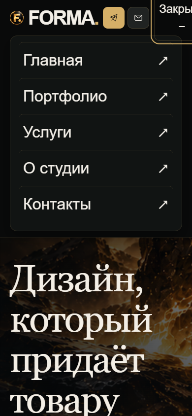
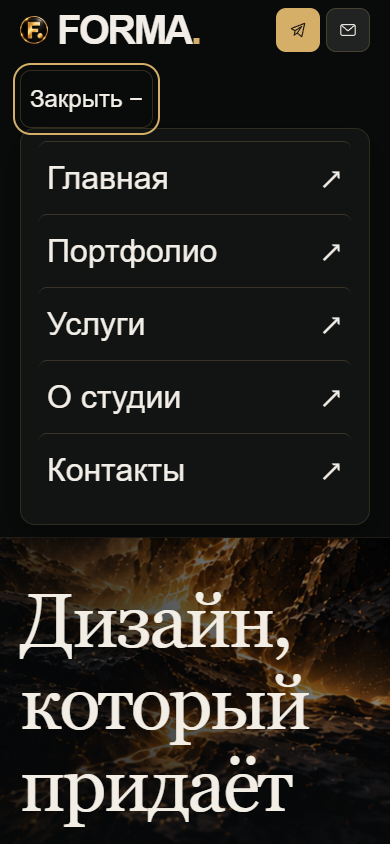
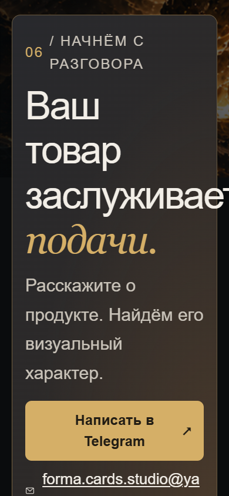
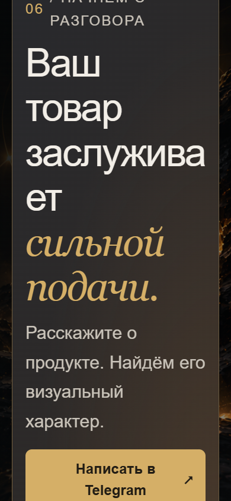

# FORMA. v1.1 — увеличение текста 200%: до / после

Проверка 21 октября 2026. База «до»: коммит bd577948ce8712e0adf132c33c68e3adefbd94c4 ветки PR №2; «после»: точечное исправление CSS в той же ветке. Подробная диагностика и результаты — [основной отчёт](../FORMA-v1.1.md). [Машинная сводка](summary.json).

## Телефон 390 px, текст 200%

| До | После |
|---|---|
|  |  |
|  |  |

## Полная матрица скриншотов

Все изображения — lossless WebP из оригинальных PNG Playwright, DPR 1. На 375/390 высота окна 844, на 768 — 1024, на 1440/1920 — 1080. Text-only resize удваивает вычисленные размеры шрифтов; системный zoom не использовался.

| Ширина | Текст | До | После |
|---:|---:|---|---|
| 375 | 100% | [Первый экран](before/375-1x-viewport.webp) · [Контакты](before/375-1x-contact.webp) · [Меню / фокус](before/375-1x-menu.webp) | [Первый экран](after/375-1x-viewport.webp) · [Контакты](after/375-1x-contact.webp) · [Меню / фокус](after/375-1x-menu.webp) |
| 375 | 200% | [Первый экран](before/375-2x-viewport.webp) · [Контакты](before/375-2x-contact.webp) · [Меню / фокус](before/375-2x-menu.webp) | [Первый экран](after/375-2x-viewport.webp) · [Контакты](after/375-2x-contact.webp) · [Меню / фокус](after/375-2x-menu.webp) |
| 390 | 100% | [Первый экран](before/390-1x-viewport.webp) · [Контакты](before/390-1x-contact.webp) · [Меню / фокус](before/390-1x-menu.webp) | [Первый экран](after/390-1x-viewport.webp) · [Контакты](after/390-1x-contact.webp) · [Меню / фокус](after/390-1x-menu.webp) |
| 390 | 200% | [Первый экран](before/390-2x-viewport.webp) · [Контакты](before/390-2x-contact.webp) · [Меню / фокус](before/390-2x-menu.webp) | [Первый экран](after/390-2x-viewport.webp) · [Контакты](after/390-2x-contact.webp) · [Меню / фокус](after/390-2x-menu.webp) |
| 768 | 100% | [Первый экран](before/768-1x-viewport.webp) · [Меню / фокус](before/768-1x-menu.webp) | [Первый экран](after/768-1x-viewport.webp) · [Меню / фокус](after/768-1x-menu.webp) |
| 768 | 200% | [Первый экран](before/768-2x-viewport.webp) · [Меню / фокус](before/768-2x-menu.webp) | [Первый экран](after/768-2x-viewport.webp) · [Меню / фокус](after/768-2x-menu.webp) |
| 1440 | 100% | [Первый экран](before/1440-1x-viewport.webp) | [Первый экран](after/1440-1x-viewport.webp) |
| 1440 | 200% | [Первый экран](before/1440-2x-viewport.webp) | [Первый экран](after/1440-2x-viewport.webp) |
| 1920 | 100% | [Первый экран](before/1920-1x-viewport.webp) | [Первый экран](after/1920-1x-viewport.webp) |
| 1920 | 200% | [Первый экран](before/1920-2x-viewport.webp) | [Первый экран](after/1920-2x-viewport.webp) |

## Доказательства

- [DOM/геометрия, ошибки и фокус до](before/results.json).
- [DOM/геометрия, ошибки и фокус после](after/results.json).
- [Сводка утверждений и попиксельное сравнение первого экрана 100%](summary.json).

При обычном тексте первый экран совпадает попиксельно на всех пяти ширинах. В контактном блоке телефонов меняется только перенос акцентной фразы, без изменения размеров блока/страницы. При 200% шапка на телефонах становится двухстрочной, чтобы сохранить полный текст и размер кнопки. При 768/1440/1920 композиция не менялась.

Браузерный скрипт: [check-text-resize.cjs](../../tools/check-text-resize.cjs). Playwright устанавливается вне репозитория; runtime-зависимости сайта не добавляются. Внутри репозитория находится только тестовый инструмент и исключённые из стандартного Pages-артефакта отчёты. Публикация не выполнялась.

Полностраничные PNG всех размеров сохранены дополнительно во временном каталоге `C:\Users\user\AppData\Local\Temp\forma-pr2-text200-20261021-153520`. В репозитории оставлены 40 снимков: первый экран на всех размерах, меню и мобильный контактный блок до/после.
